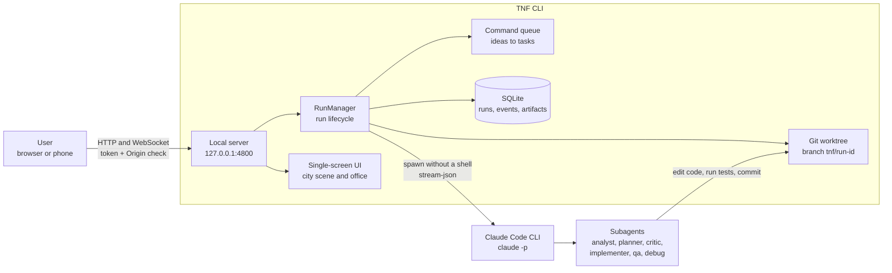
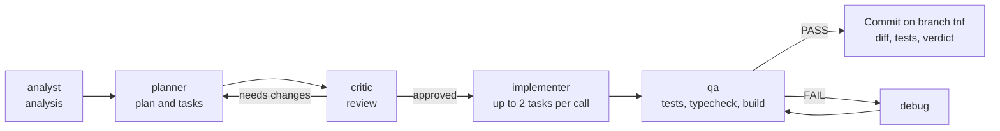
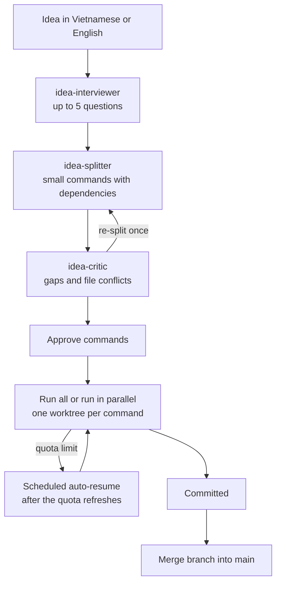

<div align="center">

<picture>
  <source media="(prefers-color-scheme: dark)" srcset="docs/assets/logo-white.png">
  
</picture>

# TNF CLI

**Give one command in Vietnamese or English. A team of Claude Code agents works on your repo, and you watch every role on a single screen.**

English | [Tiếng Việt](README.md)

[](LICENSE)
[](#install)
[](#run-from-source)
[](package.json)
[](https://github.com/sponsors/tnfrenzy)

</div>

---

A **local Windows web app** that drives the official [Claude Code CLI](https://docs.claude.com/en/docs/claude-code) (`claude -p`) with **your claude.ai subscription quota** (no API fees). Supports isolated multi-account profiles via `CLAUDE_CONFIG_DIR`, automatic failover on quota limits, and writes code in **separate git worktrees** so your main repo stays clean.

> The user interface is in Vietnamese by default (English is available in the UI). Some documents under `docs/` are in Vietnamese.

## Highlights

| | |
|---|---|
| **Multi-account Claude Code manager** | Isolated profiles via `CLAUDE_CONFIG_DIR`, persistent quota cooldowns with automatic failover between your Claude accounts, and per-role model assignment. |
| **One command, a whole team** | Type a request; the controller assigns analyst, planner, critic, implementer, qa and debug roles (with optional per-role CLI routing) and tracks every step. |
| **Safe on real repos** | Every coding run lives in a worktree on branch `tnf/<run-id>`. Agents may commit but are **blocked from push**, `rm -rf` and `reset --hard`. |
| **Evidence after every run** | Diff, test results, the qa verdict, commit milestones, line comments and a "Continue from here" button. |
| **Idea → task queue** | An idea is clarified, split into small commands with dependencies, reviewed, then run in sequence or in parallel. |
| **Auto-resume after quota limits** | When the 5-hour limit hits, the app schedules a continuation in the same session after the quota refreshes. |
| **See what agents are doing** | A city scene (with active floor glow) and an isometric 2.5D office with lifelike per-character rhythms. |
| **Works from your phone** | The UI adapts to 375 px, supports file attachments and downloads, through an authenticated tunnel (Tailscale). |
| **AI video studio (demo)** | Writes a script with AI from a form, then a CapCut-style timeline (transitions, picture motion, captions, narration, music that ducks under speech), a fast range preview and MP4 export with ffmpeg. |
| **External tools** | MCP connections, per-environment permissions, a 3D modelling workshop (CadQuery + Blender) and screenshot previews of your UI. |
| **Honest cost display** | Tokens and cost are **estimates** and are always labelled as such. |

## Diagrams

### System overview



### Life of a coding run



### From idea to merged code



## Install

### With Setup.exe (recommended, no Node needed)

1. Download `TNF-CLI-Setup-<version>.exe` from **Releases** and run it. The installer needs **no admin rights**, installs to `%LOCALAPPDATA%\TNF\Controller` and adds a system tray icon.
2. Your machine needs **Claude Code CLI signed in** with a claude.ai account (`claude auth status`) and **Git for Windows** in PATH.
3. Start **TNF CLI** from the Start Menu. To try it without spending quota, use the **demo mode** shortcut.

Installing over a newer build keeps your `data\`, `workspace\` and `controller.json`.

### Run from source

Requirements: Windows, Node.js ≥ 22.5, Git for Windows, Claude Code CLI signed in with a claude.ai subscription (no `ANTHROPIC_API_KEY`).

```powershell
git clone https://github.com/tnfrenzy/tnf-cli.git
cd tnf-cli
npm install
.\scripts\start.ps1            # real run
.\scripts\start.ps1 -Demo      # fake CLI replaying fixtures, no tokens spent
```

The server prints an address like `http://127.0.0.1:4800/#token=...`. Open exactly that address (the token is shown only once).

### Build the installer

```powershell
npm run package      # build\app\
npm run installer    # build\TNF-CLI-Setup-<version>.exe (needs Inno Setup 6)
```

## Video studio

> **Demo:** this is the 5th tower in the city scene and is still a demo; features are missing and may change.

The **Video** tower in the city scene. Create a video from a form (topic, audience, tone, key points, quick templates, style); the AI director plans the scenes, you refine them on the timeline, then render.

- **Timeline:** split, duplicate, delete, reorder and trim clips; undo and redo; insert images or videos; title cards; switch the ratio between 16:9, 9:16 and 1:1.
- **Frame fit:** blurred background, fill or black bars per clip, so a picture with the wrong ratio is not stretched.
- **Transitions and motion:** a transition at each joint, zoom or pan on pictures, clip speed, keep the original sound.
- **Text:** turn all text on or off, drag text on the preview frame, set size and colour, build captions from the narration.
- **Narration:** pick a voice (Windows voices installed on your PC) or upload an mp3/wav; adjust volume, fades, speed, split and trim; music lowers itself while speech plays.
- **Preview:** a fast low-resolution render, or only the selected part (hold Shift and drag on the ruler).
- **An AI information profile and a shared image/video library** keep the AI from inventing names and numbers.

Needs [ffmpeg](https://ffmpeg.org/) (found on PATH, or set its path in the Video Studio settings). Text goes to a voice or image service only if you configure one; Windows voices run entirely on your PC.

## Command line

```powershell
npm run tnf -- status                               # login and billing guard
npm run tnf -- accounts list                        # list Claude Code CLI accounts
npm run tnf -- accounts add "Work"                  # add an isolated Claude account
npm run tnf -- run "Add a tnf version command" --project controller
npm run tnf -- projects add controller --repo D:\code\repo --base main
npm run tnf -- list                                 # run history
npm run test:fast                                   # fast test suite (accounts, stream, i18n, release)
npm test                                            # full test suite, never calls real CLIs
```

## Safety principles

- The server listens on `127.0.0.1` only; every API call and WebSocket needs the token and passes an `Origin`/`Host` check.
- Subscription mode: `ANTHROPIC_API_KEY` is stripped, and `--bare` or `--dangerously-skip-permissions` are never used.
- `claude` is spawned without a shell; the app never edits `~/.claude/settings.json` or installs global hooks.
- Content fetched from the web is treated as untrusted data; agents do not follow instructions found in it.
- Per-environment permissions are a **guard rail for cooperative agents, not a security sandbox**.

## Documentation

| Document | Contents |
|---|---|
| [Agent Guide (AGENTS.md)](AGENTS.md) | Hard rules, 3-CLI architecture, codebase map for new agent sessions (Antigravity / Claude / Codex) |
| [Handover (HANDOVER.md)](docs/HANDOVER.md) (Vietnamese) | Current status and open items |
| [Detailed guide](docs/GUIDE.md) (Vietnamese) | Install, configuration, phone access, role library, queue, Blender |
| [Specification](docs/CONTEXT-SPEC-v1.md) (Vietnamese) | The effective system specification |
| [Queue and ideas](docs/PLANNER-QUEUE.md) (Vietnamese) | How ideas are split into tasks |
| [Quota auto-resume](docs/QUOTA-AUTO-RESUME.md) (Vietnamese) | Scheduling and restore design |
| [3D workshop](docs/DESIGN-3D.md) (Vietnamese) | 3D modelling agents and Blender rendering |
| [Video studio](#video-studio) | How AI video making works and its limits |

## Sponsor

This project is maintained by one person. If it helps your work, you can support it through **[GitHub Sponsors](https://github.com/sponsors/tnfrenzy)**. Thank you.

## License

Apache-2.0, see [LICENSE](LICENSE) and `NOTICE`. Copyright 2026 tnfrenzy. Third-party libraries keep their own licenses.
