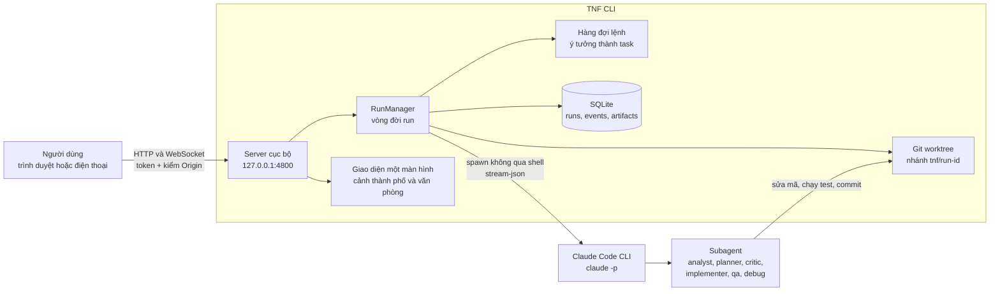
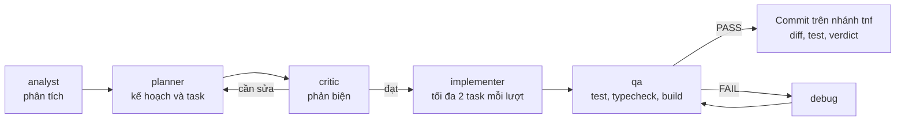
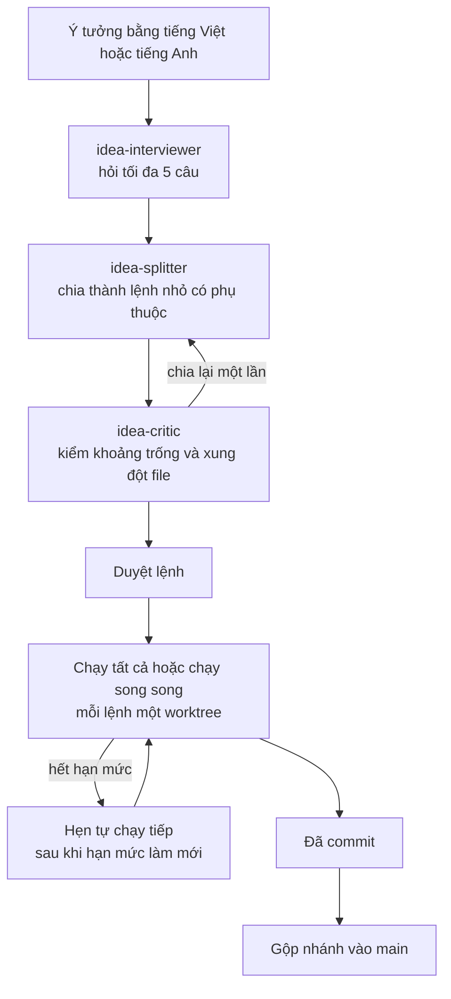

<div align="center">

<picture>
  <source media="(prefers-color-scheme: dark)" srcset="docs/assets/logo-white.png">
  
</picture>

# TNF CLI

**Ra lệnh bằng một câu tiếng Việt hoặc tiếng Anh. Một đội agent Claude Code làm việc trên repo của bạn, bạn xem từng vai làm gì ngay trên một màn hình.**

[English](README.en.md) | Tiếng Việt

[](LICENSE)
[](#cài-đặt)
[](#chạy-từ-mã-nguồn)
[](package.json)
[](https://github.com/sponsors/tnfrenzy)

</div>

---

App web chạy **cục bộ trên Windows**, điều phối **[Claude Code CLI](https://docs.claude.com/en/docs/claude-code)** (`claude -p`) gốc trên máy cá nhân bằng **hạn mức thuê bao claude.ai** (không dùng API Key). Hỗ trợ quản lý nhiều tài khoản Claude cô lập qua `CLAUDE_CONFIG_DIR`, tự chuyển dự phòng khi chạm hạn mức, và chạy lập trình trong **git worktree riêng** để repo chính luôn sạch.

## Điểm nổi bật

| | |
|---|---|
| **Quản lý nhiều tài khoản Claude Code** | Cô lập hồ sơ riêng qua `CLAUDE_CONFIG_DIR`, lưu trạng thái tạm nghỉ bền khi chạm hạn mức và tự chuyển dự phòng sang tài khoản Claude khác, phân bổ model theo từng vai. |
| **Một câu lệnh, cả đội làm việc** | Gõ yêu cầu bằng tiếng Việt hoặc tiếng Anh, controller chia vai analyst, planner, critic, implementer, qa, debug (có thể gán CLI riêng cho từng vai) và theo dõi từng bước. |
| **An toàn với repo thật** | Mỗi run lập trình chạy trong worktree và nhánh `tnf/<run-id>`, agent được commit nhưng **bị cấm push**, `rm -rf`, `reset --hard`. |
| **Bằng chứng sau mỗi run** | Diff, kết quả test, verdict của qa, mốc commit, bình luận theo dòng và nút "Tiếp tục từ đây". |
| **Hàng đợi ý tưởng → task** | Một ý tưởng được hỏi lại, chia thành lệnh nhỏ có phụ thuộc, phản biện, rồi chạy tuần tự hoặc song song. |
| **Tự chạy tiếp khi hết hạn mức** | Gặp giới hạn 5 giờ, app hẹn giờ và tiếp tục đúng phiên cũ sau khi hạn mức làm mới. |
| **Thấy agent đang làm gì** | Cảnh thành phố (có ánh sáng tầng đang hoạt động), văn phòng 2.5D isometric với nhịp thở/gõ phím sống động từng vai; vai đang làm việc có vầng sáng, màn hình bàn sáng lên, thiết bị ở Phòng Gym và Xưởng 3D phát sáng. |
| **Dùng từ điện thoại** | Giao diện co theo khung 375 px, đính kèm tệp, tải kết quả, qua đường hầm có xác thực (Tailscale). |
| **Xưởng dựng video bằng mã (thử nghiệm)** | Claude viết mã trang hoạt hình theo thư viện chuyển động của dự án, app render từng khung bằng Edge/Chrome headless rồi ghép MP4 bằng ffmpeg; có thể đưa cảnh quay tròn cabin 3D từ Xưởng 3D vào video. |
| **Thư viện vai có lịch sử và đo chất lượng** | Lưu phiên bản và khôi phục vai/skill, gắn ca thử hồi quy cho từng vai (chạy thử bằng `claude -p` chỉ đọc), bảng hiệu quả từng vai qua các run. |
| **Hàng đợi tự dọn và tự gỡ xung đột** | Lệnh bị xung đột khi gộp nhánh phụ thuộc được vai `debug` gỡ rồi chạy tiếp; Autopilot có thể xóa lệnh đã gộp sau N ngày (ghi tóm tắt trước khi xóa). |
| **Worktree theo môi trường** | Chép tệp bị gitignore (ví dụ `.env`) và chạy lệnh setup có giới hạn thời gian trước khi agent bắt đầu. |
| **Nối công cụ ngoài** | Kết nối MCP, cấp quyền theo môi trường, xưởng dựng 3D (CadQuery + Blender), Xem trước giao diện bằng ảnh chụp. |
| **Minh bạch chi phí** | Token và chi phí hiển thị là **ước tính**, luôn ghi rõ trên giao diện. |

## Có gì mới trong 0.1.6

- **Xưởng dựng video bằng mã** thay Xưởng video AI cũ (đã gỡ), kèm bước quay tròn cabin 3D từ Xưởng 3D.
- **Văn phòng 2.5D:** hiệu ứng nhận biết agent đang làm việc, màn hình bàn sáng, vầng sáng thiết bị ở Phòng Gym và Xưởng 3D, lối đi giữa các tòa nhà.
- **Thư viện vai:** lịch sử phiên bản và khôi phục, ca thử hồi quy theo vai, bảng hiệu quả vai.
- **Hàng đợi:** tự gỡ xung đột khi gộp nhánh phụ thuộc, ghi rõ lý do lệnh lỗi, đóng các run mồ côi lúc khởi động, chuẩn bị worktree theo môi trường.
- **Autopilot:** tùy chọn xóa lệnh đã gộp sau N ngày và xóa nhánh git của lệnh đó theo các điều kiện an toàn (mặc định tắt).
- **Lịch sử:** thêm tab Dựng Video và Huấn luyện Skill; popup "Lần chạy" chỉ tải 50 run gần nhất.
- **Tốc độ:** popup mở nhanh hơn (chỉ mục truy vấn chi phí, tải trước, hiện trạng thái đang tải).
- **Sửa lỗi:** bảng phân vai "Ý tưởng" trong Cài đặt nay có tác dụng với các agent chia ý tưởng.

## Sơ đồ chức năng

### Kiến trúc tổng quan



### Vòng đời một run lập trình



### Từ ý tưởng đến mã đã gộp



## Cài đặt

### Bằng Setup.exe (khuyên dùng, không cần Node)

1. Tải `TNF-CLI-Setup-<phiên bản>.exe` ở mục **Releases**, chạy. Bộ cài **không cần quyền admin**, cài vào `%LOCALAPPDATA%\TNF\Controller`, có biểu tượng ở khay hệ thống.
2. Máy cần sẵn: **Claude Code CLI đã đăng nhập** bằng tài khoản claude.ai (`claude auth status`), và **Git for Windows** trong PATH.
3. Mở **TNF CLI** từ Start Menu. Muốn thử không tốn hạn mức, chọn lối tắt **chế độ demo**.

Cài đè bản mới vẫn giữ `data\`, `workspace\` và `controller.json`.

### Chạy từ mã nguồn

Yêu cầu: Windows, Node.js ≥ 22.5, Git for Windows, Claude Code CLI đã đăng nhập thuê bao claude.ai (không đặt `ANTHROPIC_API_KEY`).

```powershell
git clone https://github.com/tnfrenzy/tnf-cli.git
cd tnf-cli
npm install
.\scripts\start.ps1            # chạy thật
.\scripts\start.ps1 -Demo      # CLI giả, phát lại fixture, không tốn token
```

Server in một địa chỉ dạng `http://127.0.0.1:4800/#token=...`, hãy mở đúng địa chỉ đó (token chỉ in một lần).

### Dựng bộ cài

```powershell
npm run package      # build\app\
npm run installer    # build\TNF-CLI-Setup-<phiên bản>.exe (cần Inno Setup 6)
```

## Xưởng dựng video

> **Thử nghiệm:** đây là tòa nhà thứ 5 trong cảnh thành phố. Xưởng video AI kiểu timeline trước đây đã được gỡ và thay bằng bản dựng bằng mã này; tính năng còn thiếu và có thể thay đổi.

Tòa nhà **Video** trong cảnh thành phố. Bạn mô tả video cần làm, vai `video-coder` (Claude) viết mã một trang hoạt hình theo thư viện chuyển động và mẫu phong cách của dự án, app dựng bản nháp, chụp bảng khung để tự kiểm, rồi dựng bản cuối.

- **Cách dựng:** trang HTML/JS do Claude viết chạy trong Edge/Chrome headless; bộ render tua từng khung, chụp ảnh rồi ghép thành MP4 bằng ffmpeg.
- **Quay tròn cabin 3D:** Xưởng 3D render cảnh quay tròn (turntable) của mẫu cabin, Xưởng video chép vào dự án để dùng làm cảnh quay.
- **An toàn:** agent chỉ đọc và ghi trong thư mục dự án video (Read, Grep, Glob, Write, Edit); không có Bash, không có mạng. Trang do Claude viết bị chặn mạng ở bộ render, chỉ đọc tệp trong thư mục dự án.
- **Chi phí:** một video thử 20 giây khổ dọc 1080x1920 tốn khoảng 0,51 USD ước tính và vài phút dựng trên máy đã thử; số liệu thật phụ thuộc máy và độ dài.

Cần [ffmpeg](https://ffmpeg.org/) (tự tìm trong PATH hoặc khai đường dẫn ở Cài đặt Xưởng video) và trình duyệt Edge hoặc Chrome. Thư viện chuyển động nằm ở `config/codevideo/`, xem `config/codevideo/MOTION.md`.

## Dòng lệnh

```powershell
npm run tnf -- status                               # đăng nhập và billing guard
npm run tnf -- accounts list                        # danh sách tài khoản Claude Code CLI
npm run tnf -- accounts add "Work"                  # thêm tài khoản Claude cô lập hồ sơ riêng
npm run tnf -- run "Thêm lệnh tnf version" --project controller
npm run tnf -- projects add controller --repo D:\code\repo --base main
npm run tnf -- list                                 # lịch sử các lần chạy
npm run test:fast                                   # bộ test nhanh (accounts, stream, i18n, release)
npm test                                            # toàn bộ test suite, không gọi CLI thật
```

## Nguyên tắc an toàn

- Server chỉ lắng nghe `127.0.0.1`; mọi API và WebSocket cần token và được kiểm `Origin`/`Host`.
- Chạy ở chế độ thuê bao Claude Code: xóa `ANTHROPIC_API_KEY`, không bao giờ dùng `--bare` hay `--dangerously-skip-permissions`.
- Spawn `claude` không qua shell; không sửa `~/.claude/settings.json`, không cài hook toàn cục.
- Nội dung lấy từ web là dữ liệu không tin cậy, agent không làm theo chỉ dẫn nằm trong đó.
- Cấp quyền theo môi trường là **rào chắn cho agent hợp tác, không phải hộp cát bảo mật**.

## Tài liệu

| Tài liệu | Nội dung |
|---|---|
| [Hướng dẫn Agent (AGENTS.md)](AGENTS.md) | Quy tắc cứng, lệnh kiểm thử và bản đồ mã nguồn cho phiên agent mới |
| [Bàn giao (HANDOVER.md)](docs/HANDOVER.md) | Trạng thái hiện tại và các việc mở |
| [Hướng dẫn chi tiết](docs/GUIDE.md) | Cài đặt, cấu hình, điện thoại, thư viện vai, hàng đợi, Blender |
| [Đặc tả](docs/CONTEXT-SPEC-v1.md) | Đặc tả hiệu lực của hệ thống |
| [Hàng đợi và ý tưởng](docs/PLANNER-QUEUE.md) | Cách chia ý tưởng thành task |
| [Tự chạy tiếp khi hết hạn mức](docs/QUOTA-AUTO-RESUME.md) | Thiết kế hẹn giờ và khôi phục |
| [Xưởng dựng 3D](docs/DESIGN-3D.md) | Agent dựng mẫu 3D và render Blender |
| [Đánh giá vai](docs/ROLE-EVAL.md) | Ca thử hồi quy theo vai và cách lưu điểm |
| [Hiệu quả vai](docs/ROLE-STATS.md) | Bảng hiệu quả từng vai và các gợi ý |
| [Chuẩn bị worktree](docs/WORKTREE-SETUP.md) | Chép tệp bị gitignore và chạy lệnh setup |
| [Xưởng dựng video](#xưởng-dựng-video) | Cách dựng video bằng mã và giới hạn hiện tại |

## Tài trợ

Dự án do một người duy trì. Nếu app giúp ích cho công việc của bạn, bạn có thể ủng hộ qua **[GitHub Sponsors](https://github.com/sponsors/tnfrenzy)**. Cảm ơn bạn.

## Giấy phép

Apache-2.0, xem [LICENSE](LICENSE) và `NOTICE`. Bản quyền 2026 tnfrenzy. Thư viện bên thứ ba giữ giấy phép riêng của chúng.
