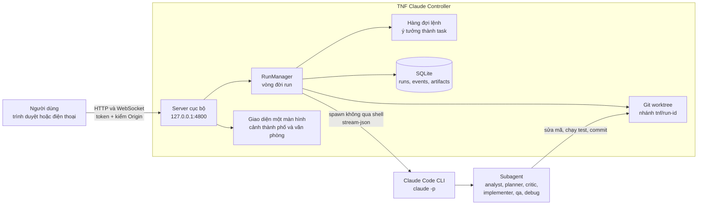
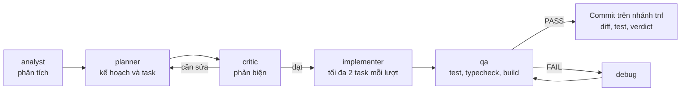
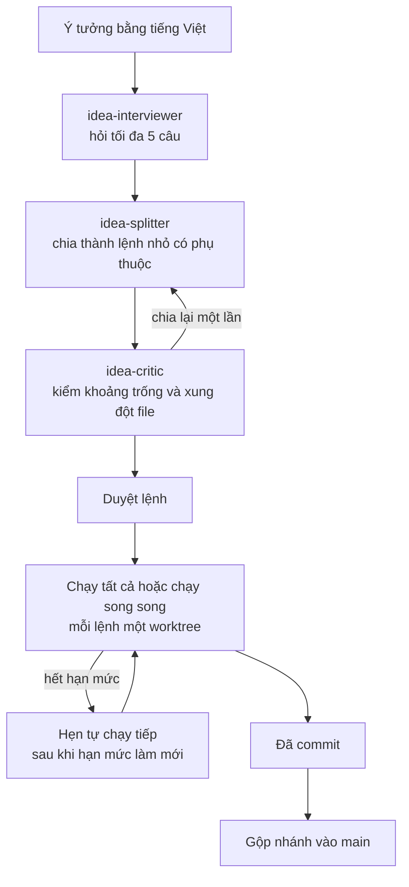

<div align="center">

<picture>
  <source media="(prefers-color-scheme: dark)" srcset="docs/assets/logo-white.png">
  
</picture>

# TNF Claude Controller

**Ra lệnh bằng một câu tiếng Việt. Một đội agent Claude Code làm việc trên repo của bạn, bạn xem từng vai làm gì ngay trên một màn hình.**

[](LICENSE)
[](#cài-đặt)
[](#chạy-từ-mã-nguồn)
[](package.json)
[](https://github.com/sponsors/tnfrenzy)

</div>

---

App web chạy **cục bộ trên Windows**, điều phối [Claude Code CLI](https://docs.claude.com/en/docs/claude-code) (`claude -p`) bằng **hạn mức thuê bao claude.ai** của bạn, không phát sinh phí API. Một phiên điều phối các subagent (phân tích, lập kế hoạch, phản biện, viết mã, kiểm thử, gỡ lỗi), mã được viết trong **git worktree riêng** để repo chính luôn sạch.

## Điểm nổi bật

| | |
|---|---|
| **Một câu lệnh, cả đội làm việc** | Gõ yêu cầu tiếng Việt, controller chia vai analyst, planner, critic, implementer, qa, debug và theo dõi từng bước. |
| **An toàn với repo thật** | Mỗi run lập trình chạy trong worktree và nhánh `tnf/<run-id>`, agent được commit nhưng **bị cấm push**, `rm -rf`, `reset --hard`. |
| **Bằng chứng sau mỗi run** | Diff, kết quả test, verdict của qa, mốc commit, bình luận theo dòng và nút "Tiếp tục từ đây". |
| **Hàng đợi ý tưởng → task** | Một ý tưởng được hỏi lại, chia thành lệnh nhỏ có phụ thuộc, phản biện, rồi chạy tuần tự hoặc song song. |
| **Tự chạy tiếp khi hết hạn mức** | Gặp giới hạn 5 giờ, app hẹn giờ và tiếp tục đúng phiên cũ sau khi hạn mức làm mới. |
| **Thấy agent đang làm gì** | Cảnh thành phố, mỗi tầng là một project; văn phòng isometric cho từng vai đi lại, dùng công cụ, báo lỗi. |
| **Dùng từ điện thoại** | Giao diện co theo khung 375 px, đính kèm tệp, tải kết quả, qua đường hầm có xác thực (Tailscale). |
| **Nối công cụ ngoài** | Kết nối MCP, cấp quyền theo môi trường, xưởng dựng 3D (Blender), Xem trước giao diện bằng ảnh chụp. |
| **Minh bạch chi phí** | Token và chi phí hiển thị là **ước tính**, luôn ghi rõ trên giao diện. |

## Sơ đồ chức năng

### Kiến trúc tổng quan



### Vòng đời một run lập trình



### Từ ý tưởng đến mã đã gộp



## Cài đặt

### Bằng Setup.exe (khuyên dùng, không cần Node)

1. Tải `TNF-Claude-Controller-Setup-<phiên bản>.exe` ở mục **Releases**, chạy. Bộ cài **không cần quyền admin**, cài vào `%LOCALAPPDATA%\TNF\Controller`, có biểu tượng ở khay hệ thống.
2. Máy cần sẵn: **Claude Code CLI đã đăng nhập** bằng tài khoản claude.ai (`claude auth status`), và **Git for Windows** trong PATH.
3. Mở **TNF Claude Controller** từ Start Menu. Muốn thử không tốn hạn mức, chọn lối tắt **chế độ demo**.

Cài đè bản mới vẫn giữ `data\`, `workspace\` và `controller.json`.

### Chạy từ mã nguồn

Yêu cầu: Windows, Node.js ≥ 22.5, Claude Code CLI ≥ 2.1.281 đã đăng nhập, không đặt `ANTHROPIC_API_KEY`.

```powershell
git clone https://github.com/tnfrenzy/tnf-claude-controller.git
cd tnf-claude-controller
npm install
.\scripts\start.ps1            # chạy thật
.\scripts\start.ps1 -Demo      # CLI giả, phát lại fixture, không tốn token
```

Server in một địa chỉ dạng `http://127.0.0.1:4800/#token=...`, hãy mở đúng địa chỉ đó (token chỉ in một lần).

### Dựng bộ cài

```powershell
npm run package      # build\app\
npm run installer    # build\TNF-Claude-Controller-Setup-<phiên bản>.exe (cần Inno Setup 6)
```

## Dòng lệnh

```powershell
npm run tnf -- status                               # đăng nhập và billing guard
npm run tnf -- run "Thêm lệnh tnf version" --project controller
npm run tnf -- projects add controller --repo D:\code\repo --base main
npm run tnf -- list                                 # lịch sử các lần chạy
npm test                                            # hơn 4.000 test, không gọi Claude thật
```

## Nguyên tắc an toàn

- Server chỉ lắng nghe `127.0.0.1`; mọi API và WebSocket cần token và được kiểm `Origin`/`Host`.
- Chạy ở chế độ thuê bao: xóa `ANTHROPIC_API_KEY`, không bao giờ dùng `--bare` hay `--dangerously-skip-permissions`.
- Spawn `claude` không qua shell; không sửa `~/.claude/settings.json`, không cài hook toàn cục.
- Nội dung lấy từ web là dữ liệu không tin cậy, agent không làm theo chỉ dẫn nằm trong đó.
- Cấp quyền theo môi trường là **rào chắn cho agent hợp tác, không phải hộp cát bảo mật**.

## Tài liệu

| Tài liệu | Nội dung |
|---|---|
| [Hướng dẫn chi tiết](docs/GUIDE.md) | Cài đặt, cấu hình, điện thoại, thư viện vai, hàng đợi, Blender |
| [Bàn giao](docs/HANDOVER.md) | Trạng thái hiện tại và bước kế tiếp |
| [Đặc tả](docs/CONTEXT-SPEC-v1.md) | Đặc tả hiệu lực của hệ thống |
| [Hàng đợi và ý tưởng](docs/PLANNER-QUEUE.md) | Cách chia ý tưởng thành task |
| [Tự chạy tiếp khi hết hạn mức](docs/QUOTA-AUTO-RESUME.md) | Thiết kế hẹn giờ và khôi phục |
| [Xưởng dựng 3D](docs/DESIGN-3D.md) | Agent dựng mẫu 3D và render Blender |

## Tài trợ

Dự án do một người duy trì. Nếu app giúp ích cho công việc của bạn, bạn có thể ủng hộ qua **[GitHub Sponsors](https://github.com/sponsors/tnfrenzy)**. Cảm ơn bạn.

## Giấy phép

Apache-2.0, xem [LICENSE](LICENSE) và `NOTICE`. Bản quyền 2026 tnfrenzy. Thư viện bên thứ ba giữ giấy phép riêng của chúng.
